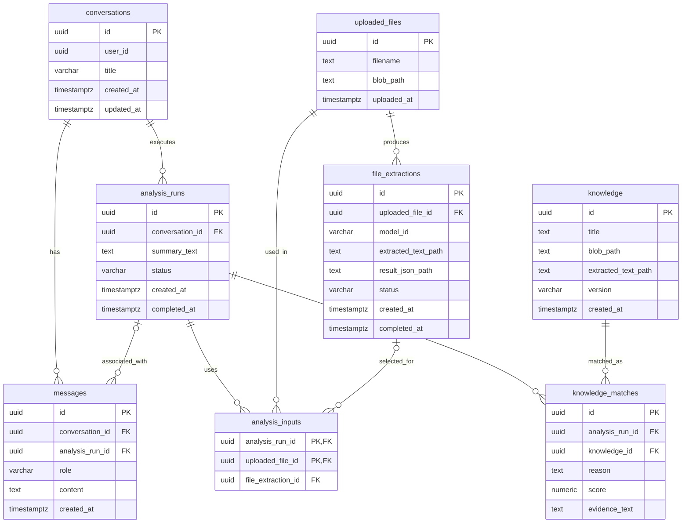
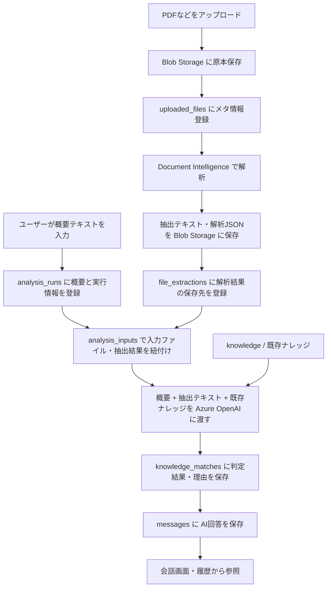

# 関連ナレッジ判定アプリケーション DB設計書

## 1. 概要

### 1.1 目的

ユーザーが入力した**概要テキスト**と**アップロード資料**（Azure AI Document Intelligenceによる抽出結果）をもとに、事前登録済みのナレッジから関連資料を判定する。判定結果およびチャット履歴を保存し、左サイドバーから会話を再開できるようにする。

### 1.2 前提・保存方針

- RDBMS：**Azure Database for PostgreSQL**（型はPostgreSQLを想定）。
- ファイル原本、抽出テキスト、Document Intelligenceの解析JSON：**Azure Blob Storage**に保存する。
- PostgreSQLにはファイルのメタデータ、Blobの格納先、判定入力、関連ナレッジの判定結果、会話履歴を保存する。
- `uploaded_files` はユーザーがアップロードした資料、`knowledge` は管理者等が事前登録した参照ナレッジを表す。
- 1会話内で判定を複数回実行でき、1判定で複数ファイルを利用できる。
- `file_extractions` は同一アップロードファイルの再解析に対応するため、`uploaded_files` に対して1対多とする。
- 以下は**基本設計案**。ユーザー管理、権限制御、監査ログ、ナレッジ改訂履歴は要件確定に合わせて拡張する。

## 2. テーブル一覧

| No. | テーブル名 | 論理名 | 主な役割 |
|---:|---|---|---|
| 1 | `conversations` | 会話 | 左サイドバーに表示する会話セッションを管理 |
| 2 | `messages` | 会話メッセージ | ユーザーの質問とAIの回答を時系列で管理 |
| 3 | `analysis_runs` | 判定実行 | 概要テキストと関連ナレッジ判定の実行履歴を管理 |
| 4 | `analysis_inputs` | 判定入力ファイル | 判定実行と使用したアップロードファイル・抽出結果を関連付け |
| 5 | `uploaded_files` | アップロード資料 | アップロード原本のメタ情報と格納先を管理 |
| 6 | `file_extractions` | ファイル解析結果 | Document Intelligenceの抽出結果と処理状況を管理 |
| 7 | `knowledge` | 既存ナレッジ | 事前登録済み参照資料の情報と格納先を管理 |
| 8 | `knowledge_matches` | 関連ナレッジ判定結果 | 関連すると判定された既存ナレッジ・理由・根拠を管理 |

## 3. ER図

> `messages.analysis_run_id` および `analysis_inputs.file_extraction_id` はNULLを許可する設計案。Mermaidの関係線は論理的な関係を示し、NULL可否等の正確な制約は次節に従う。

## 4. テーブル定義

### 4.1 `conversations` — 会話

| カラム名 | データ型 | 必須 | キー | 説明 |
|---|---|---|---|---|
| `id` | UUID | ○ | PK | 会話ID |
| `user_id` | UUID | ○ | — | 会話の所有ユーザーID。ユーザー管理テーブル導入時にFK化 |
| `title` | VARCHAR(200) | ○ | — | 左サイドバーに表示するタイトル |
| `created_at` | TIMESTAMPTZ | ○ | — | 作成日時 |
| `updated_at` | TIMESTAMPTZ | ○ | — | 最終更新日時 |

### 4.2 `messages` — 会話メッセージ

| カラム名 | データ型 | 必須 | キー | 説明 |
|---|---|---|---|---|
| `id` | UUID | ○ | PK | メッセージID |
| `conversation_id` | UUID | ○ | FK → `conversations.id` | 所属会話 |
| `analysis_run_id` | UUID | — | FK → `analysis_runs.id` | 関連する判定実行。通常の追加質問はNULLでもよい |
| `role` | VARCHAR(20) | ○ | — | `user` / `assistant` |
| `content` | TEXT | ○ | — | 発言本文 |
| `created_at` | TIMESTAMPTZ | ○ | — | 発言日時 |

### 4.3 `analysis_runs` — 判定実行

| カラム名 | データ型 | 必須 | キー | 説明 |
|---|---|---|---|---|
| `id` | UUID | ○ | PK | 判定実行ID |
| `conversation_id` | UUID | ○ | FK → `conversations.id` | 判定を実施した会話 |
| `summary_text` | TEXT | — | — | ユーザー入力の概要テキスト。ファイルのみの入力ならNULL可 |
| `status` | VARCHAR(20) | ○ | — | `pending` / `processing` / `completed` / `failed` |
| `created_at` | TIMESTAMPTZ | ○ | — | 判定開始日時 |
| `completed_at` | TIMESTAMPTZ | — | — | 判定終了日時 |

### 4.4 `analysis_inputs` — 判定入力ファイル

| カラム名 | データ型 | 必須 | キー | 説明 |
|---|---|---|---|---|
| `analysis_run_id` | UUID | ○ | 複合PK、FK → `analysis_runs.id` | 判定実行ID |
| `uploaded_file_id` | UUID | ○ | 複合PK、FK → `uploaded_files.id` | 使用したアップロードファイル |
| `file_extraction_id` | UUID | — | FK → `file_extractions.id` | 判定に使用した抽出結果。抽出完了前はNULL可 |

**複合主キー：** (`analysis_run_id`, `uploaded_file_id`)

> `file_extraction_id` を設定する場合、その解析結果の `uploaded_file_id` が同一行の `uploaded_file_id` と一致することをDB制約またはアプリケーション層で保証する。PostgreSQLでは `file_extractions(id, uploaded_file_id)` にUNIQUE制約を追加し、複合外部キーで強制できる。

### 4.5 `uploaded_files` — アップロード資料

| カラム名 | データ型 | 必須 | キー | 説明 |
|---|---|---|---|---|
| `id` | UUID | ○ | PK | アップロードファイルID |
| `filename` | TEXT | ○ | — | 元のファイル名 |
| `blob_path` | TEXT | ○ | — | 原本のBlob格納先 |
| `uploaded_at` | TIMESTAMPTZ | ○ | — | アップロード日時 |

### 4.6 `file_extractions` — ファイル解析結果

| カラム名 | データ型 | 必須 | キー | 説明 |
|---|---|---|---|---|
| `id` | UUID | ○ | PK | 解析結果ID |
| `uploaded_file_id` | UUID | ○ | FK → `uploaded_files.id` | 解析対象のアップロード資料 |
| `model_id` | VARCHAR(100) | ○ | — | Document Intelligenceのモデル識別子 |
| `extracted_text_path` | TEXT | — | — | 抽出テキストのBlob格納先。成功前はNULL |
| `result_json_path` | TEXT | — | — | 生の解析JSONのBlob格納先。成功前はNULL |
| `status` | VARCHAR(20) | ○ | — | `pending` / `processing` / `completed` / `failed` |
| `created_at` | TIMESTAMPTZ | ○ | — | 解析開始日時 |
| `completed_at` | TIMESTAMPTZ | — | — | 解析終了日時 |

同一のファイルを再解析する場合は、既存行を上書きせず、新しい `file_extractions` 行を追加する。

### 4.7 `knowledge` — 既存ナレッジ

| カラム名 | データ型 | 必須 | キー | 説明 |
|---|---|---|---|---|
| `id` | UUID | ○ | PK | ナレッジID |
| `title` | TEXT | ○ | — | ナレッジ資料名 |
| `blob_path` | TEXT | ○ | — | 原本のBlob格納先 |
| `extracted_text_path` | TEXT | — | — | 比較に使用するテキストのBlob格納先 |
| `version` | VARCHAR(30) | — | — | 資料のバージョン |
| `created_at` | TIMESTAMPTZ | ○ | — | 登録日時 |

### 4.8 `knowledge_matches` — 関連ナレッジ判定結果

| カラム名 | データ型 | 必須 | キー | 説明 |
|---|---|---|---|---|
| `id` | UUID | ○ | PK | 判定結果ID |
| `analysis_run_id` | UUID | ○ | FK → `analysis_runs.id` | 判定実行ID |
| `knowledge_id` | UUID | ○ | FK → `knowledge.id` | 関連すると判定された既存ナレッジ |
| `reason` | TEXT | ○ | — | 関連すると判断した理由 |
| `score` | NUMERIC(5,4) | — | — | 関連度。0〜1などの定義を行った場合のみ使用 |
| `evidence_text` | TEXT | — | — | 根拠箇所の抜粋 |

**推奨制約：** 同一判定で同じナレッジを重複登録しない場合、`UNIQUE(analysis_run_id, knowledge_id)` を設定する。

## 5. リレーション一覧

| 親 | 子 | 関係 | 外部キー |
|---|---|---|---|
| `conversations` | `messages` | 1:N | `messages.conversation_id` |
| `conversations` | `analysis_runs` | 1:N | `analysis_runs.conversation_id` |
| `analysis_runs` | `messages` | 1:N（任意関連） | `messages.analysis_run_id` |
| `analysis_runs` | `analysis_inputs` | 1:N | `analysis_inputs.analysis_run_id` |
| `uploaded_files` | `analysis_inputs` | 1:N | `analysis_inputs.uploaded_file_id` |
| `uploaded_files` | `file_extractions` | 1:N | `file_extractions.uploaded_file_id` |
| `file_extractions` | `analysis_inputs` | 1:N（任意関連） | `analysis_inputs.file_extraction_id` |
| `analysis_runs` | `knowledge_matches` | 1:N | `knowledge_matches.analysis_run_id` |
| `knowledge` | `knowledge_matches` | 1:N | `knowledge_matches.knowledge_id` |

## 6. 処理・データフロー

### 6.1 会話再開時

1. サイドバー表示時、ログインユーザーに属する `conversations` を `updated_at` 降順で取得する。
2. 履歴選択時、指定された会話の `messages` を日時順で取得する。
3. 必要に応じて `analysis_runs`、`analysis_inputs`、`uploaded_files`、`file_extractions`、`knowledge_matches`、`knowledge` を結合して過去の判定条件と結果を復元する。
4. 続けて質問する場合、必要な過去メッセージと関連する抽出テキスト・ナレッジをAzure OpenAIに渡す。**画面に履歴を表示するだけでは、AIに過去の文脈が自動で渡されるわけではない。**
5. 新しいユーザー発言とAI回答を `messages` に追加し、`conversations.updated_at` を更新する。

## 7. 推奨インデックス・制約

- `conversations(user_id, updated_at DESC)`：履歴一覧を高速化。
- `messages(conversation_id, created_at, id)`：会話を安定した順序で取得。
- `analysis_runs(conversation_id, created_at DESC)`：会話内の判定履歴取得。
- `analysis_inputs(uploaded_file_id)`、`analysis_inputs(file_extraction_id)`：参照先からの探索。
- `file_extractions(uploaded_file_id, created_at DESC)`：対象ファイルの最新解析結果取得。
- `knowledge_matches(analysis_run_id)`：判定結果取得。
- `knowledge_matches(analysis_run_id, knowledge_id)`：必要に応じてUNIQUE制約。
- `messages.role`、各`status`にはCHECK制約またはENUM相当の制約を設定する。
- `score`を0〜1に定義するならCHECK制約（`score BETWEEN 0 AND 1`）を設定する。
- アクセス時には `conversations.user_id` に基づいて所有者を検証し、他ユーザーの会話やファイルの参照を禁止する。
- `messages.analysis_run_id` を指定した場合、同じ `conversation_id` に属していることを保証する。
- 関連資料の根拠を長期的に再現する必要がある場合、参照した**ナレッジのバージョンを固定**する（バージョン別テーブルの導入、または不変のナレッジレコードを利用）。

## 8. 今後の検討事項

| 項目 | 検討内容 |
|---|---|
| ナレッジの版管理 | 更新前の資料・抽出テキストを参照できるようにするか |
| 判定結果の粒度 | 関連ありだけでなく、関連なしの候補も保存するか |
| 根拠位置 | `evidence_text` に加え、ページ番号・セクション・座標等を保存するか |
| 再実行時の文脈 | 過去の判定結果を再利用するか、新規判定として扱うか |
| エラー管理 | 解析・判定失敗時のエラーコードや再試行回数を保持するか |
| 削除方針 | 会話削除時の資料・解析結果・Blob原本の扱い |
| ファイルの所有権 | アップロードユーザーID、共有範囲、会話との紐付けが必要か |

---

**設計方針の要点：** `conversations` と `messages` で会話履歴を管理し、`analysis_runs` と `knowledge_matches` で判定履歴を管理する。入力原本は `uploaded_files`、Document Intelligenceの解析結果は `file_extractions`、既存の比較対象は `knowledge` に分離する。
